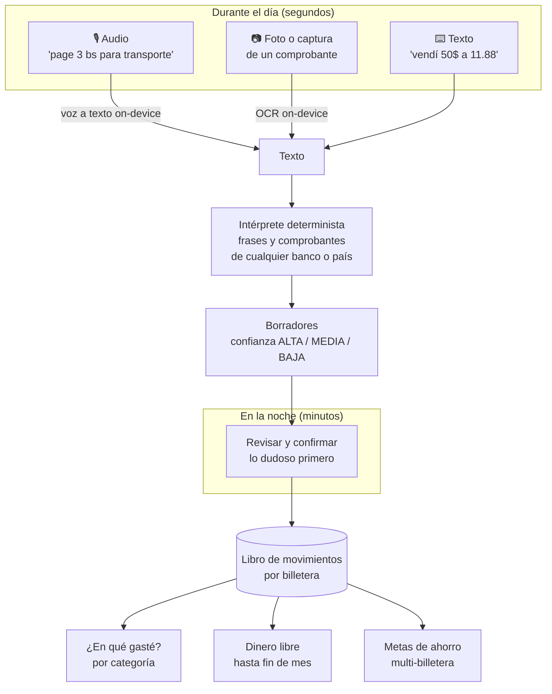
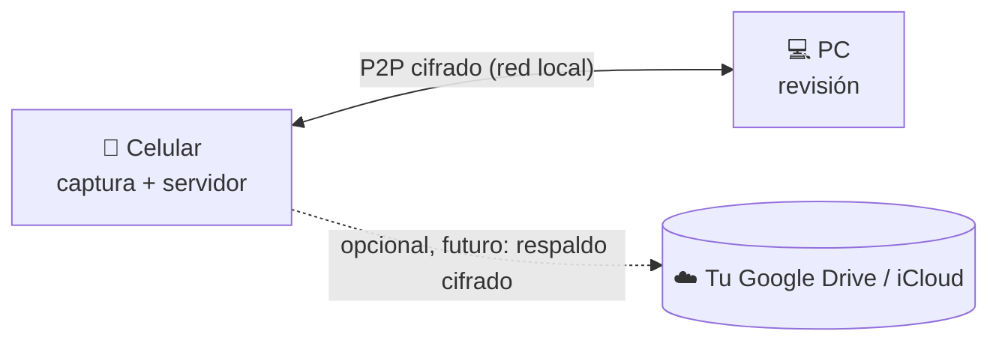

# CoinDen

**Finanzas personales multimoneda, local-first y sin servidores, pensadas para economías con brecha cambiaria.**

CoinDen responde dos preguntas con precisión:

1. **¿En qué se me fue el dinero este mes?**
2. **¿Me alcanza para la hamburguesa o sigo comiendo sopa?**

## El problema

En países como Bolivia, la vida financiera de una persona normal está fragmentada:

- Saldo en **Meru** (dólares digitales / USDT).
- **Dólares en billete** que se cambian en la calle al paralelo.
- **Bolivianos en el banco** para pagar el almuerzo con QR.
- **Efectivo** para el micro y las compras del día.

Las apps del mercado (Wallet, Toshl, YNAB, Mobills) no sirven aquí:

- **Exigen un servidor.** Hay que crear una cuenta en la nube, los datos quedan en manos de terceros, no funcionan bien offline y cobran suscripción en dólares.
- **No entienden la mezcla de monedas.** Convierten con la tasa oficial que nadie usa en la calle, o directamente no dejan combinar billeteras de distintas monedas.
- **Resultado:** uno termina en Excel o en las notas del celular, y nadie sabe en qué gasta de verdad.

## Cómo funciona



- **Todo termina en texto.** Voz a texto y OCR solo *perciben* (on-device); un único intérprete determinista convierte ese texto en borradores. Entiende frases ("page 3 bs para trasmporte") y comprobantes de cualquier banco por su estructura; las palabras de cada idioma (inglés base; español y portugués instalables) y los formatos de bancos conocidos (Yape, Banco Económico...) son datos, no código.
- **Todo borrador es una recomendación.** Cada campo dice de dónde salió (el comprobante, lo que dijiste, una regla, una sugerencia) y el borrador tiene confianza ALTA, MEDIA o BAJA. Una frase sin billetera sugiere efectivo; si fue con QR, habrías compartido el comprobante.
- **Categoría, medio de pago y billetera son cosas distintas.** "Almuerzo 45 Bs con QR": la *categoría* es Comida y el *medio* es QR, que no dice de qué cuenta salió (todos los bancos aceptan QR). CoinDen te sugiere una de tus cuentas que aceptan QR, con confianza baja, y la confirmas en la revisión; si dices "bnb" o compartes el comprobante, ya sabe cuál fue. El efectivo en Bs y en dólares son billeteras distintas.
- **El cambio de moneda es una operación con su propia tasa.** "Vendí 50 USD a 11.88" mueve dinero de una billetera en USD a una en BOB con *esa* tasa.
- **Dinero libre** = saldo confirmado − recurrentes pendientes − cuotas de préstamos + cobros esperados − aportes a metas.
- **La categorización aprende de tus correcciones.** Cada corrección en la revisión se convierte en una regla local, que se puede explicar y vive solo en tus dispositivos.
- **Tu celular es tu servidor.** Durante el día capturas en el celular y en la noche revisas en la computadora. Los dos se sincronizan punto a punto, cifrados, sin pasar por ninguna nube.



## Principios

Los principios completos están en [MANIFIESTO.md](MANIFIESTO.md). En resumen:

- **Local-first:** tus datos viven en tus dispositivos y la app funciona al 100% sin internet.
- **Cero servidores de CoinDen:** sin cuenta obligatoria ni suscripción. Sincronización P2P entre tus dispositivos.
- **Tasas reales:** la que tú usas, no la oficial.
- **IA determinista y on-device:** reglas que se pueden probar y explicar. Voz a texto y OCR solo del sistema operativo, sin enviar nada fuera.
- **Dinero exacto:** enteros en unidades mínimas, sin flotantes.

## Camino al MVP

**MVP:** instalas CoinDen en Android, registras tus gastos del día (texto, voz o comprobante compartido desde Yape o tu banco), los revisas en la noche y ves tus saldos reales y en qué se te fue el dinero del mes. Todo sin servidores.

| # | Capacidad | Qué aporta al MVP | Tipo | Tamaño | Estado |
|---|---|---|---|---|---|
| 0 | `currency-configuration` | monedas, tasas reales y patrimonio consolidado | dominio | — | ✅ |
| 1 | `wallet-management` | billeteras, libro de movimientos y control estricto de saldo | dominio | — | ✅ |
| — | `domain-i18n-cleanup` · `money-precision` | dominio sin idioma y dinero exacto (`Money * ExchangeRate`) | dominio | — | ✅ |
| 2 | `draft-inbox` | borradores como máquina de estados, bandeja y confirmación idempotente | dominio | — | ✅ |
| 2b | `text-interpreter` | frases y comprobantes de cualquier banco, en/es/pt, confianza ALTA/MEDIA/BAJA | dominio | — | ✅ |
| — | `exchange-phrases` | cambios de moneda por entrada y salida ("vendí 11 dólares, me dieron 112 bs") | dominio | S | ✅ |
| 3 | `expense-categorization` | **¿en qué se me fue?**: categorías que aprenden de tus correcciones | dominio | L | ✅ |
| 4 | `android-app-shell` | módulo Android con Compose, dominio compilado para Android, inyección de dependencias | infraestructura | M | ✅ |
| 5 | `local-persistence` | SQLDelight + SQLCipher: billeteras, libro, borradores y alias, cifrados | adaptador | L | ✅ |
| — | `payment-method-hints` | QR, Pix o efectivo son medios de pago, no billeteras: filtran candidatas | dominio | S | ✅ |
| — | `app-theme` | identidad visual Cobre (claro y oscuro), tipografías y tarjeta de borrador | UI | M | ✅ |
| 6 | `onboarding-wallets-ui` | moneda local y tasa, billeteras, alias y billetera por defecto | UI | M | 🔜 siguiente |
| 7 | `capture-ui` + compartir a CoinDen | captura rápida y comprobantes compartidos desde Yape o el banco | UI + adaptador | M | |
| 8 | `perception-adapters` | voz a texto y OCR on-device → texto para el intérprete | adaptador | M | |
| 9 | `review-inbox-ui` | la bandeja de la noche: lo dudoso primero, completar y confirmar | UI | M | |
| 10 | `insights-ui` | saldos, patrimonio consolidado y gasto del mes por categoría | UI | M | |
| 11 | `rate-fetch-adapter` | cotizaciones reales por red (Frankfurter, DolarApi, selector web) | adaptador | S | |

### Después del MVP

| Capacidad | Qué aporta |
|---|---|
| `free-to-spend` | dinero libre hasta fin de mes: ¿hamburguesa o sopa? |
| `commitments` | gastos esperados del mes (Netflix "cuando puedo", no un día fijo), préstamos (debo / me deben) y reparto en cuotas |
| `savings-goals` | metas de ahorro repartidas en varias billeteras |
| `device-sync` | el celular como servidor y sincronización P2P cifrada con la PC |
| `cloud-backup` (premium) | respaldo cifrado en la nube propia del usuario |
| Intérprete | detectar comprobantes duplicados, más plantillas de bancos y paquetes de idioma (datos que puede aportar la comunidad), traducción con IA solo como respaldo |
| Plataformas | iOS, Desktop y Web con Compose Multiplatform |

> El modelo de datos se diseña **sync-ready desde hoy**, con IDs UUID y movimientos append-only. Así la sincronización y el respaldo no van a exigir reescribir nada.

## Sostenibilidad

CoinDen quiere vivir de sus usuarios, no de sus datos:

- **El núcleo es gratis para siempre.** Registrar, revisar, categorizar, metas y sincronizar entre tus dispositivos no se cobran.
- **Donaciones:** si CoinDen te ayuda, puedes invitar un café. *(Los enlaces se agregarán cuando estén listos.)*
- **Premium (futuro):** solo comodidades, como el respaldo cifrado en tu propia nube. Nunca encierra tus datos.
- **Sin publicidad y sin venta de datos.**

## Stack

- **Kotlin Multiplatform** (hoy solo con target JVM para el dominio), JDK 21.
- **Arquitectura hexagonal:** `core/domain` es Kotlin puro, sin frameworks; el mundo exterior entra por puertos.
- **Spec-Driven Development con [OpenSpec](https://github.com/Fission-AI/OpenSpec):** specs en `openspec/specs/` y cambios en `openspec/changes/`.
- **Calidad:** ktlint, husky + lint-staged + commitlint (Conventional Commits) y GitHub Actions.

## Desarrollo

Requisitos: JDK 21, Node.js (solo para los hooks de git) y, para la app, el Android SDK (plataforma 34).
Gradle encuentra el SDK por `ANDROID_HOME` o por `local.properties` (`sdk.dir=...`, no se versiona);
Android Studio crea ese archivo al abrir el proyecto.

```bash
npm install
```

```bash
npm test
```

```bash
npm run lint
```

```bash
npm run format
```

```bash
npm run build:android
```

`npm test` corre las pruebas del dominio (unitarias y de feature con las personas), la batería de contrato de los
almacenamientos (en memoria y base local) y las de la app en la JVM. El cifrado de la base se prueba en un emulador
o teléfono conectado con `./gradlew :core:data-local:connectedDebugAndroidTest`. `npm run build:android` genera el APK de depuración en
`composeApp/build/outputs/apk/debug/`; el CI lo publica como artefacto en cada push.

Si trabajas con agentes de IA, lee [AGENTS.md](AGENTS.md).
