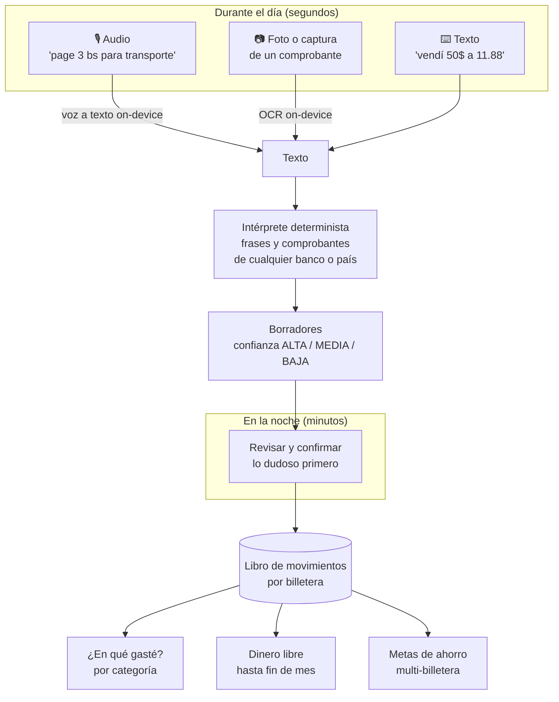
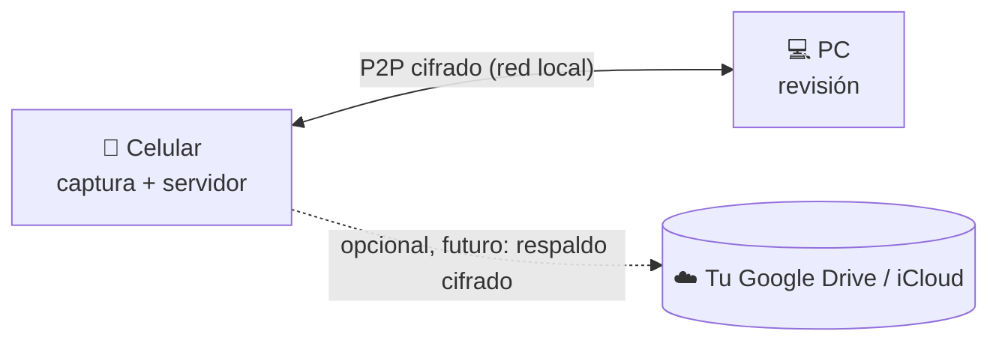

# CoinDen

**Finanzas personales multimoneda, local-first y sin servidores, pensadas para economías con brecha cambiaria.**

CoinDen responde dos preguntas con precisión:

1. **¿En qué se me fue el dinero este mes?**
2. **¿Me alcanza para la hamburguesa o sigo comiendo sopa?**

## El problema

En países como Bolivia, la vida financiera de una persona normal está fragmentada:

- Saldo en **Meru** (dólares digitales / USDT).
- **Dólares en billete** que se cambian en la calle al paralelo.
- **Bolivianos en el banco** para pagar el almuerzo con QR.
- **Efectivo** para el micro y las compras del día.

Las apps del mercado (Wallet, Toshl, YNAB, Mobills) no sirven aquí:

- **Exigen un servidor.** Hay que crear una cuenta en la nube, los datos quedan en manos de terceros, no funcionan bien offline y cobran suscripción en dólares.
- **No entienden la mezcla de monedas.** Convierten con la tasa oficial que nadie usa en la calle, o directamente no dejan combinar billeteras de distintas monedas.
- **Resultado:** uno termina en Excel o en las notas del celular, y nadie sabe en qué gasta de verdad.

## Cómo funciona



- **Todo termina en texto.** Voz a texto y OCR solo *perciben* (on-device); un único intérprete determinista convierte ese texto en borradores. Entiende frases ("page 3 bs para trasmporte") y comprobantes de cualquier banco por su estructura; las palabras de cada idioma (inglés base; español y portugués instalables) y los formatos de bancos conocidos (Yape, Banco Económico...) son datos, no código.
- **Todo borrador es una recomendación.** Cada campo dice de dónde salió (el comprobante, lo que dijiste, una regla, una sugerencia) y el borrador tiene confianza ALTA, MEDIA o BAJA. Una frase sin billetera sugiere efectivo; si fue con QR, habrías compartido el comprobante.
- **Categoría y medio de pago son ejes distintos.** "Almuerzo 45 Bs con QR": la *categoría* es Comida y el *medio* es la billetera Banco.
- **El cambio de moneda es una operación con su propia tasa.** "Vendí 50 USD a 11.88" mueve dinero de una billetera en USD a una en BOB con *esa* tasa.
- **Dinero libre** = saldo confirmado − recurrentes pendientes − cuotas de préstamos + cobros esperados − aportes a metas.
- **La categorización aprende de tus correcciones.** Cada corrección en la revisión se convierte en una regla local, que se puede explicar y vive solo en tus dispositivos.
- **Tu celular es tu servidor.** Durante el día capturas en el celular y en la noche revisas en la computadora. Los dos se sincronizan punto a punto, cifrados, sin pasar por ninguna nube.



## Principios

Los principios completos están en [MANIFIESTO.md](MANIFIESTO.md). En resumen:

- **Local-first:** tus datos viven en tus dispositivos y la app funciona al 100% sin internet.
- **Cero servidores de CoinDen:** sin cuenta obligatoria ni suscripción. Sincronización P2P entre tus dispositivos.
- **Tasas reales:** la que tú usas, no la oficial.
- **IA determinista y on-device:** reglas que se pueden probar y explicar. Voz a texto y OCR solo del sistema operativo, sin enviar nada fuera.
- **Dinero exacto:** enteros en unidades mínimas, sin flotantes.

## Roadmap

| # | Capacidad | Estado |
|---|-----------|--------|
| 0 | `currency-configuration`: monedas, tasas reales, consolidado | ✅ hecho |
| 1 | `wallet-management`: billeteras, libro de movimientos, cambio con tasa propia | ✅ hecho |
| — | `domain-i18n-cleanup`: dominio sin textos de idioma | ✅ hecho (limpieza) |
| — | `money-precision`: `Money` encapsulado y `Money * ExchangeRate` exacto | ✅ hecho (limpieza) |
| 2 | `draft-inbox`: borradores como máquina de estados, bandeja de revisión y confirmación idempotente | ✅ hecho |
| 2b | `text-interpreter`: intérprete agnóstico de frases y comprobantes (paquetes en/es/pt y plantillas como datos), confianza ALTA/MEDIA/BAJA por borrador | ✅ hecho |
| 3 | `expense-categorization`: reglas + aprendizaje por corrección | |
| 4 | `commitments`: gastos esperados del mes (Netflix "cuando puedo", no un día fijo), préstamos (debo / me deben) y reparto en cuotas | |
| 5 | `free-to-spend`: dinero libre y la pregunta de la hamburguesa | |
| 6 | `savings-goals`: metas de ahorro repartidas en varias billeteras | |
| 7 | `perception-adapters`: voz a texto y OCR on-device → texto para el intérprete (la interpretación ya está en 2b) | |
| 8 | `device-sync`: celular como servidor, sincronización P2P cifrada con la PC | |
| 9 | `cloud-backup` (premium): respaldo cifrado en la nube propia del usuario | futuro |

Mejoras anotadas para el intérprete (2b): detectar comprobantes duplicados por número de transacción, más plantillas de bancos y más paquetes de idioma (datos que puede aportar la comunidad), y traducción con IA solo como respaldo opcional para idiomas sin paquete.

En paralelo vendrán la persistencia cifrada (SQLite/SQLCipher) y la UI en Compose Multiplatform (Android, iOS, Desktop, Web).

> El modelo de datos se diseña **sync-ready desde hoy**, con IDs UUID y movimientos append-only. Así las capacidades 8 y 9 no van a exigir reescribir nada.

## Sostenibilidad

CoinDen quiere vivir de sus usuarios, no de sus datos:

- **El núcleo es gratis para siempre.** Registrar, revisar, categorizar, metas y sincronizar entre tus dispositivos no se cobran.
- **Donaciones:** si CoinDen te ayuda, puedes invitar un café. *(Los enlaces se agregarán cuando estén listos.)*
- **Premium (futuro):** solo comodidades, como el respaldo cifrado en tu propia nube. Nunca encierra tus datos.
- **Sin publicidad y sin venta de datos.**

## Stack

- **Kotlin Multiplatform** (hoy solo con target JVM para el dominio), JDK 21.
- **Arquitectura hexagonal:** `core/domain` es Kotlin puro, sin frameworks; el mundo exterior entra por puertos.
- **Spec-Driven Development con [OpenSpec](https://github.com/Fission-AI/OpenSpec):** specs en `openspec/specs/` y cambios en `openspec/changes/`.
- **Calidad:** ktlint, husky + lint-staged + commitlint (Conventional Commits) y GitHub Actions.

## Desarrollo

Requisitos: JDK 21 y Node.js (solo para los hooks de git).

```bash
npm install
```

```bash
npm test
```

```bash
npm run lint
```

```bash
npm run format
```

`npm test` ejecuta `./gradlew :core:domain:jvmTest`, que corre las pruebas unitarias y las de feature con las personas.

Si trabajas con agentes de IA, lee [AGENTS.md](AGENTS.md).
