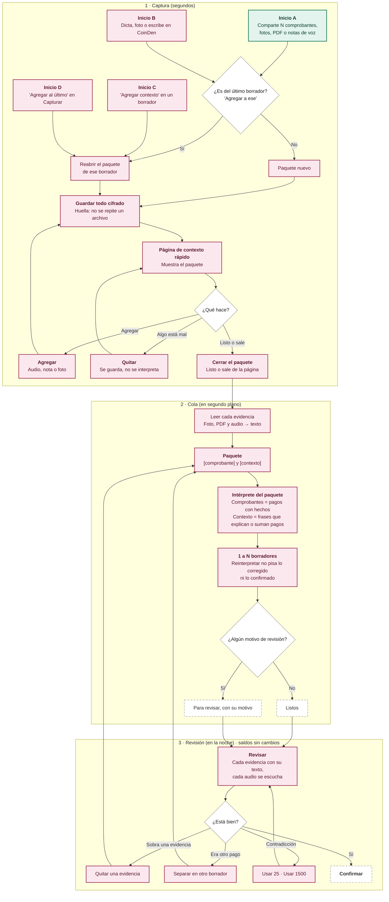

# Design

## Context

- **Borradores:** cada borrador es un flujo de `DraftEvent` (`Captured`, `Interpreted`, `Perceived`, `Revised`, `Merged`, …).
- **Evidencia del borrador:** el encabezado guarda la evidencia original, la de los borradores unidos (`extraEvidence`) y un único `perceivedText`.
- **Intérprete:** `TextDraftInterpreter` lee **un** texto (frase o comprobante) y devuelve propuestas. `ProposalMerge` combina dos propuestas al unir borradores ("Son el mismo").
- **Persistencia:** la base local guarda todos los eventos en una tabla genérica `events` (flujo, tipo, versión y JSON). El esquema está en la versión 2 (`1.sqm`), que es con la que salió la 0.1.0. Los eventos de tipo desconocido se conservan intactos.
- **Cola:** `PerceptionService` lee los borradores `Captured` con archivo sin leer, de a uno.
- **Compartir:** `ShareActivity` es translúcida, acepta un solo archivo (`ACTION_SEND`), guarda y vuelve a la otra app.

## Diagrama de acciones

Dos inicios llevan a crear un paquete: compartir (A) y capturar en la app (B). Otros dos reabren uno que ya existe: "Agregar contexto" en un borrador (C) y "Agregar al último" (D). La cola y la revisión son pasos del mismo flujo.



## Goals / Non-Goals

**Goals:**
- **El paquete es un flujo de eventos propio:** append-only, sync-ready y con UUID. Junta las evidencias y produce los borradores.
- **Un solo intérprete:** el intérprete del paquete es lógica pura en `core/domain`, con las palabras en los paquetes de idioma.
- **Ningún dato existente se borra ni se reescribe:** lo de la 0.1.0 se lee tal cual.

**Non-Goals:**
- El repaso del día, que es el próximo cambio.
- Detectar por qué la persona salió de la app.
- Mover una evidencia entre paquetes distintos.

## Decisions

### 1. Paquete de captura: `CaptureBundle` y `BundleEvent`

Se crea un flujo nuevo por paquete, `bundle:<uuid>`, guardado en la misma tabla `events` con tipos nuevos. Los eventos son:

| Evento | Qué registra |
|---|---|
| `BundleOpened` | Que el paquete empezó |
| `EvidenceAttached` | `evidenceId` UUID, `Evidence` y `role`. El rol es `RECEIPT` para imagen, PDF o texto compartido de comprobante, y `CONTEXT` para audio o nota agregados |
| `EvidenceExcluded` | `evidenceId` |
| `EvidencePerceived` | `evidenceId`, `text` y `engine` |
| `BundleClosed` | Que el paquete se cerró |
| `BundleReopened` | Que el paquete se reabrió |
| `BundleSplit` | `evidenceId` → `newBundleId` |

`BundleProjection` arma el estado del paquete: evidencias en orden, quitadas, texto leído por evidencia, abierto o cerrado, y borradores producidos.

**Por qué no seguir con `extraEvidence` en el borrador:** un paquete puede producir N borradores, y la lectura tiene que llegar al paquete aunque sus borradores cambien o se descarten.

**Alternativa descartada:** un borrador "padre". Mezcla dos ciclos de vida distintos.

### 2. Borradores ligados al paquete

- **Paquete de origen:** `DraftEvent.Captured` suma `bundleId` y `paymentKey`, ambos opcionales. `paymentKey` identifica el pago dentro del paquete: el `evidenceId` del comprobante que lo funda, o `context:<monto>:<medio>` para un pago que solo sale de lo dicho.
- **Motivos de revisión:** `DraftEvent.Interpreted` suma `reviewReasons: Set<ReviewReason>`, que es un enum sin textos:
  - `ASSIGNED_BY_ORDER`;
  - `CONTEXT_FOR_SEVERAL`;
  - `CONTRADICTION` (con `stated` y `read`);
  - `PAYMENT_WITHOUT_RECEIPT`.

  Con algún motivo, la confianza baja a MEDIA y el borrador va a "Para revisar".
- **Borradores de la 0.1.0:** no tienen `bundleId`. Al leerlos, se proyectan como un paquete virtual cerrado con su evidencia, **sin escribir nada**. Se materializa un `bundle:<draftId>` solo si la persona lo reabre.

### 3. Intérprete del paquete: el modelo propone, las reglas verifican

Interpretar **qué quiso decir** la persona (qué pagó, a quién, qué audio explica qué comprobante)
es tarea del modelo de lenguaje local, no de listas de palabras por idioma. Lo define el cambio
`interprete-por-modelo`; aquí solo se usa su contrato.

```
BundleInterpreter.interpret(texts, wallets)
  1. IntentInterpreterPort.interpret(texts, wallets, categories)  -> propuestas, o null
  2. ProposalValidator.validate(...)  sobre cada propuesta
  3. sin modelo, o propuesta rechazada -> respaldo determinista
  4. lo dudoso sale con su ReviewReason
```

- **Los comprobantes siguen siendo reglas.** Un comprobante son hechos, no lenguaje: lo leen las
  plantillas y el lector genérico, como siempre. El modelo no los reinterpreta.
- **El validador manda.** Ninguna propuesta llega a un borrador sin pasar por él: el monto tiene
  que estar en alguna evidencia, la billetera y la categoría tienen que existir, y los hechos del
  comprobante no se cambian.
- **Sin modelo no se pierde el paquete:** cada comprobante da su pago con sus hechos, el contexto
  queda como nota y el borrador va a revisar. Menos listo, nunca mal registrado.
- **Si el modelo y las reglas no coinciden**, el borrador va a revisar mostrando las dos lecturas.

**Lo que se descartó:** un `ContextPhraseReader` con conectores, frases de referencia y verbos de
pago a una persona, todo por idioma. Resolvía los escenarios de la spec a costa de una lista nueva
por cada caso nuevo, y eso no escala a "mundial desde el día 1".

### 4. Reinterpretar sin pisar: `BundleReconciler`

Cuando se cierra el paquete, o se reabre y se vuelve a cerrar, la salida del intérprete se reconcilia por `paymentKey` con los borradores del paquete:

| Caso | Qué pasa |
|---|---|
| Borrador pendiente con la misma `paymentKey` | Recibe un `Interpreted` nuevo. Los campos `CORRECTED` del borrador se restauran sobre la propuesta |
| Borrador confirmado | No se toca, y su pago no genera otro borrador |
| `paymentKey` nueva | `Captured` (con `bundleId`) más `Interpreted` |
| Borrador pendiente cuya clave ya no sale | `Discarded(mergedInto = bundleId)` |

Todo son eventos nuevos; nada se reescribe.

### 5. Cola

`pendingBundleIds()` devuelve los paquetes **cerrados** con evidencias de archivo sin `EvidencePerceived` y no quitadas.

- `perceive(bundleId)` lee de a una evidencia ("Un Trabajo a la Vez").
- Cuando ya no queda ninguna por leer, o las que quedan no se pueden leer (`NothingRead`, `NeedsVoiceModel`), llama a `interpretBundle`.
- Los borradores `Captured` sueltos de la 0.1.0 se siguen leyendo con el camino actual.

### 6. Captura y página de contexto

**`ShareActivity`:**
- acepta también `ACTION_SEND_MULTIPLE`;
- guarda cada archivo con `EvidenceAttached` y descarta los de huella repetida;
- en el mismo fondo translúcido muestra `ContextPage`, de Compose y común, en `commonMain`.

**`ContextPage`:**
- lista las evidencias con su estado;
- tiene los botones Grabar audio, Escribir nota, Sumar foto, Quitar y Listo;
- muestra el aviso "¿Es del último borrador?" cuando hay un borrador pendiente y el paquete es nuevo.

**Cierre:** se dispara en `onStop` de la actividad o pantalla, o al tocar Listo. **Sin temporizadores.**

**Captura en la app:** dictar, foto o escribir abren la misma `ContextPage` antes de la tarjeta del resultado. La tarjeta muestra los N borradores después del cierre.

**Grabador:** el puerto `ContextRecorder` tiene un adaptador Android con `MediaRecorder` (AAC/m4a), sin dependencias nuevas. Cifra con `attachments`.

**"Agregar al último" y "Agregar contexto":** navegan a `ContextPage(bundleId)` con `BundleReopened`.

### 7. Revisión

`EvidenceViewer` recibe el paquete:
- muestra cada evidencia con su texto o transcripción, y cada audio con su propio reproductor;
- tiene las acciones **Quitar** (`EvidenceExcluded`) y **Separar** (`BundleSplit` más cierre de los dos paquetes);
- los motivos se traducen en la presentación;
- `CONTRADICTION` ofrece "Usar X". Elegir hace un `Revised` con el campo como `CORRECTED`.

### 8. Actualizar sin perder datos

- **Sin migración de esquema:** este cambio no modifica el esquema. Los eventos nuevos van en `events` con tipos nuevos, y los campos nuevos de los DTO son opcionales con valor por defecto.
- **Prueba de migración:** se agrega `migrations/schema-2.db` (el esquema de la 0.1.0) y `verifyMigrations` en SQLDelight. También una prueba en `jvmTest` que crea una base con el esquema 2, guarda eventos de la 0.1.0 (billeteras, libro, borradores con foto, categorías) y los lee con el código nuevo sin diferencias.
- **Regla para cambios futuros:** todo cambio de esquema trae su `.sqm` y su base de la versión anterior en la prueba.
- **Firma y llave de cifrado:** la firma es la misma por Play App Signing. La llave de SQLCipher la guarda el Keystore del sistema, y una actualización de la app la conserva.

## Risks / Trade-offs

- **Interpretar mal un paquete complejo:** se mitiga con motivos de revisión visibles, Quitar, Separar y "Usar X". Nada toca saldos sin confirmar.
- **Lenguaje natural variado:** las reglas cubren los casos de las specs. Lo que no entiendan queda como contexto explicativo o para revisar, nunca como dato silencioso. El modelo de lenguaje opcional mejora esto más adelante.
- **Más eventos por captura:** son eventos chicos en la misma tabla. Se mide el tiempo de carga de la bandeja con 500 borradores en la prueba de la base local.
- **Aviso "¿Es del último borrador?":** puede molestar. Solo aparece si hay un borrador pendiente y se puede ignorar sin tocar nada.
