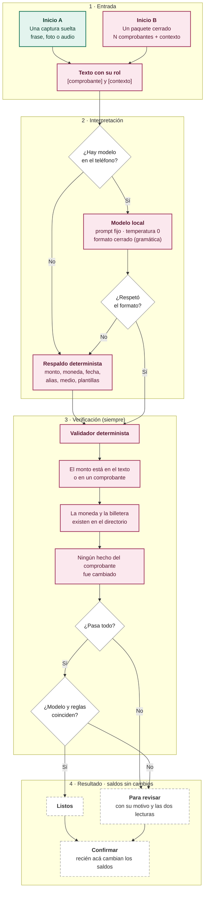

# Design

## Context

- **El Manifiesto ya fijó la dirección** (principio 4): el modelo interpreta primero, las reglas verifican y son el respaldo. El spec de `text-interpreter` dice lo contrario ("sin usar la red ni modelos") y el código siguió al spec. Este cambio corrige el spec.
- **La infraestructura ya está.** `release.yml` instala NDK y CMake para compilar **whisper.cpp** (el modelo de voz). `llama.cpp` es del mismo autor y el mismo runtime `ggml`: el proyecto ya compila C++ nativo para Android, ya descarga y verifica modelos por huella, y ya tiene la pantalla que explica qué corre en el teléfono.
- **El contrato de salida ya existe.** `MovementProposal` (gasto, ingreso, transferencia, ajuste) y `BundlePayment` son tipos cerrados del dominio. El modelo no necesita un formato nuevo: necesita producir **esos**.
- **Qué entiende hoy el código:** 18 listas de palabras por idioma. Reconocen verbos y categorías; no entienden a quién se le pagó ni qué audio explica qué comprobante.

## Inventario: qué se elimina, qué pasa al modelo y qué queda como dato

| Lista de hoy | Para qué sirve | Destino |
|---|---|---|
| `expenseWords`, `incomeWords`, `withdrawalWords`, `exchangeWords` | El tipo de movimiento de una frase | **Al modelo.** Sin modelo, una frase es un gasto |
| `categoryWords` | "almuerzo" → Comida | **Al modelo.** Sin modelo quedan las reglas aprendidas de la persona |
| `conjunctions`, `notePrepositions`, `receivedMarkers`, `rateMarkers` | Cortar la frase, encontrar la nota | **Se eliminan.** Partir el lenguaje es trabajo del modelo |
| `genericWalletWords` | "banco", "cuenta" no son apodos | **Se elimina.** El modelo elige del directorio, que es un dato cerrado |
| `amountLabels`, `counterpartyLabels`, `accountLabels`, `noteLabels`, `referenceLabels` | Campos de un comprobante sin plantilla | **Queda como dato.** Un comprobante es estructura, no lenguaje |
| `months` | Fechas con el mes en letras | **Queda como dato.** Es una tabla, no lenguaje |
| `currencyWords` | "dolares" → USD | **Queda como dato.** Tabla cerrada por moneda |
| `paymentMethodWords` | "qr", "efectivo" → filtrar billeteras | **Queda como dato.** Vocabulario chico y cerrado, que el respaldo necesita |
| `ReceiptTemplates` | Formatos de banco | **Queda como dato.** Son hechos, y no deben depender de un modelo |

Las que quedan ya viven en archivos JSON gracias al cambio `paquetes-como-datos`; este cambio **borra las demás de esos archivos**, no las mueve.

## Diagrama de acciones

Dos inicios llegan al intérprete: una captura suelta (A) y un paquete de captura cerrado (B). Los dos pasan por el modelo cuando está, y los dos pasan **siempre** por la verificación determinista.



## Decisions

### 1. El puerto del modelo

```
IntentInterpreterPort
  interpret(texts: List<BundleText>, wallets: WalletDirectory, categories: List<CategoryRef>)
    → List<BundlePayment>?      // null = no hay modelo, o su respuesta se descartó
```

- **La misma firma que ya tiene `BundleInterpreterPort`.** Una captura suelta es un paquete de una sola evidencia, así que no hacen falta dos contratos.
- **Devuelve los tipos del dominio, no texto.** El adaptador traduce la salida del modelo a `BundlePayment`; si no puede, devuelve `null` y manda el respaldo.
- **`wallets` y `categories` viajan en el prompt** como listas cerradas con sus IDs. El modelo elige de ahí; cualquier ID que no esté se descarta en la verificación.

### 2. Formato cerrado de verdad: gramática, no promesas

Pedirle a un modelo de 0,6B que "responda JSON" falla seguido. La solución no es reintentar: es **no dejarlo escribir otra cosa**. `llama.cpp` acepta una gramática GBNF y en cada paso de decodificación enmascara los tokens que la violarían, así que la salida **no puede** salirse del formato ([llama.cpp/grammars](https://github.com/ggml-org/llama.cpp/blob/master/grammars/README.md)).

La gramática se genera del esquema de `BundlePayment`: tipo de movimiento, monto como cadena de dígitos, moneda de una lista cerrada, `walletId` de una lista cerrada, nota libre y `paymentKey`. El modelo no ve el esquema, así que el prompt de sistema también lo describe.

Esto cumple al pie de la letra el principio 4 ("responde con temperatura 0 y solo con un formato cerrado") sin confiar en la buena voluntad del modelo.

### 3. El validador es la pieza que no se negocia

Toda propuesta —del modelo o del respaldo— pasa por el mismo validador puro en `core/domain`:

| Comprobación | Qué rechaza |
|---|---|
| El monto aparece en el texto interpretado o en un comprobante | Montos inventados |
| La moneda existe y es la del comprobante si lo hay | Cambios de moneda en silencio |
| El `walletId` está en el directorio | Billeteras inventadas |
| La categoría está entre las de la persona | Categorías inventadas |
| Ningún campo `EVIDENCE` del comprobante cambió | Pisar los hechos del comprobante |

Lo que no pasa no se usa como hecho: se marca el motivo y el borrador va a revisar. **El validador es determinista y tiene sus propias pruebas**, independientes del modelo.

### 4. Cuando los dos hablan

Con modelo instalado se corren **los dos** caminos: el modelo y el respaldo. Es barato (el respaldo son microsegundos) y da la comparación que pide el Manifiesto:

- **Coinciden en los hechos** (mismo monto, moneda y billetera) → se usa la propuesta del modelo, más rica en nota y categoría. Borrador **Listo**.
- **No coinciden** → borrador **Para revisar**, mostrando qué entendió cada uno. Nunca se elige en silencio.
- **El modelo falla, tarda de más o se descarta su salida** → queda el respaldo, y el borrador va a revisar si no alcanza.

### 5. El modelo concreto

Criterios, en orden: **licencia libre** (el proyecto es MPL-2.0 y vive de donaciones), **que entre en 4 GB de RAM**, **multilingüe** (es, en, pt desde el día 1) y **que exista en GGUF** para el runtime elegido.

| Opción | Tamaño Q4 | Licencia | A favor | En contra |
|---|---|---|---|---|
| **Qwen 3 0.6B** | ~0,4 GB | Apache 2.0 | La más libre; multilingüe fuerte; entra en el piso de 4 GB con margen | El más chico: más dependiente de la gramática y de la verificación |
| **Gemma 3 1B** | ~0,7 GB | Gemma Terms | Muy citado para Android; buena calidad a 1B | Licencia con restricciones de uso: no es software libre |
| **Llama 3.2 1B** | ~0,8 GB | Llama Community | Mucha documentación y ejemplos | Licencia con restricciones; multilingüe más flojo en pt |
| **Qwen 3 1.7B** | ~1,1 GB | Apache 2.0 | Bastante mejor en intenciones complejas | Pide 6 GB para ir cómodo |

**Recomendación: Qwen 3 0.6B (Apache 2.0) como piso y Qwen 3 1.7B como recomendado en 6 GB o más.** La licencia decide: Gemma y Llama traen condiciones de uso que no encajan con un proyecto de software libre que la gente puede redistribuir. Y como la gramática garantiza el formato y el validador verifica los hechos, el riesgo de un modelo chico es *entender de menos* (el borrador va a revisar), no *registrar mal*.

### 6. El runtime

**`llama.cpp` por NDK**, la misma vía que ya usa whisper.cpp:

- **Es lo único que garantiza el formato cerrado** con GBNF; MediaPipe y LiteRT-LM no exponen gramáticas.
- **Licencia MIT**, compatible con el proyecto.
- **La infraestructura ya existe**: `release.yml` ya instala NDK y CMake, y ya hay un puente nativo para whisper.cpp del que copiar el patrón.
- **En contra:** compilar C++ para cuatro ABIs engorda el APK y el tiempo de build. Se mitiga publicando solo arm64 para el modelo (el piso ya es arm64) y dejando el resto sin el motor.

### 7. Qué pasa con la batería y el tiempo

El criterio de aceptación es medible y está en las tareas: **una captura típica se interpreta en menos de 5 segundos en el teléfono de referencia (4 GB, arm64), sin cierres por memoria**. Se mide en un teléfono real con el modelo elegido, antes de dar el cambio por terminado. Si no se cumple, se baja de modelo o se recorta el prompt; no se acepta un "casi".

La interpretación corre en la cola, nunca mientras la persona escribe: capturar sigue tomando segundos (principio 5).

## Risks / Trade-offs

- **El modelo entiende mal y la persona no lo nota.** Es el riesgo central. Se mitiga con el validador (los hechos no se tocan), con el desacuerdo que manda a revisar y con que nada toque saldos sin confirmar.
- **Un modelo de 0,6B puede quedarse corto** en paquetes con varios pagos. Mitigación: la verificación lo convierte en "para revisar", no en un dato falso; y en teléfonos con 6 GB se usa el de 1,7B.
- **Peso de la app y del modelo.** El motor suma unos pocos MB al APK; el modelo es una descarga opcional que la persona pide y puede borrar.
- **La app queda en dos velocidades** según el teléfono. Es el precio de no tener servidores, y es explícito: la pantalla del modelo dice qué cambia al instalarlo.
- **Perder lo que hoy funciona.** Las listas que se borran hoy entienden "gasté 45 en almuerzo". Por eso el respaldo conserva monto, moneda, alias, medio, fecha y plantillas: sin modelo la app no vuelve a cero, vuelve a lo esencial.
